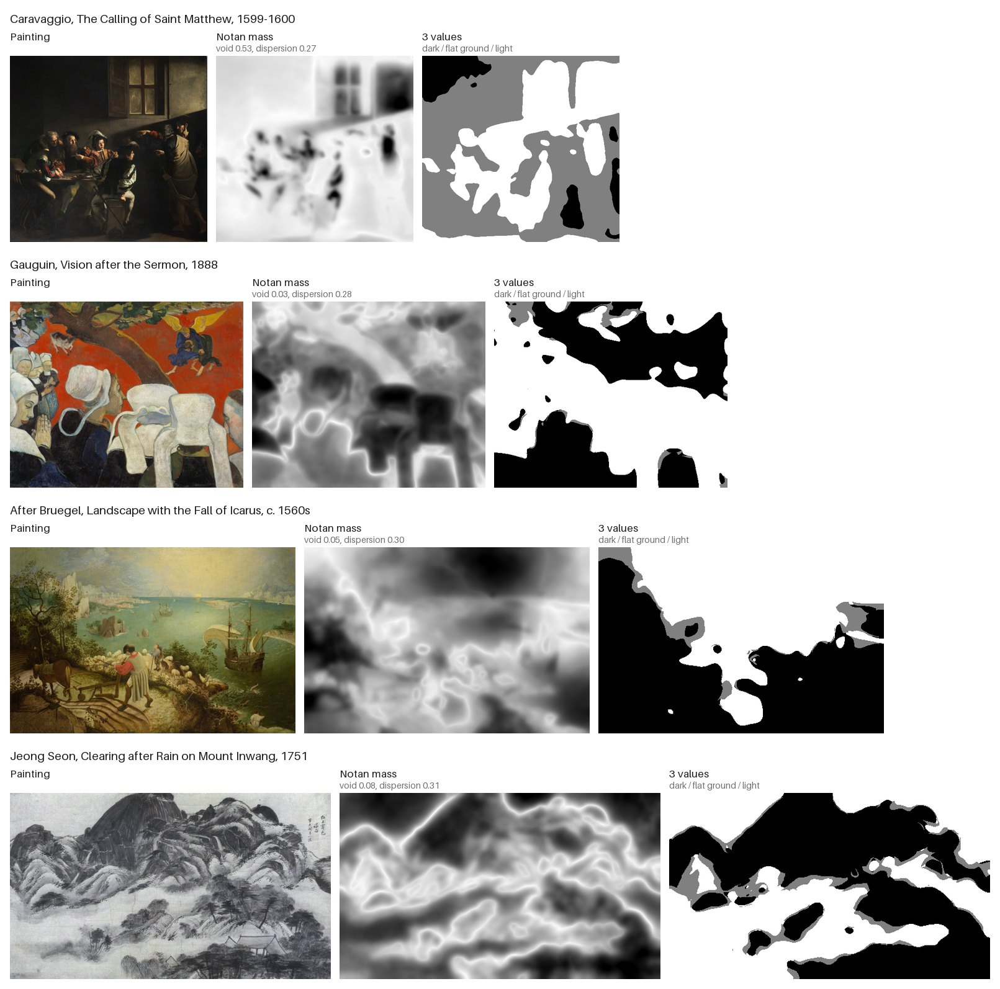
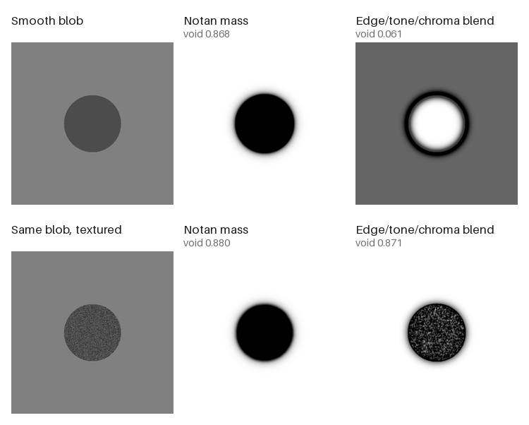
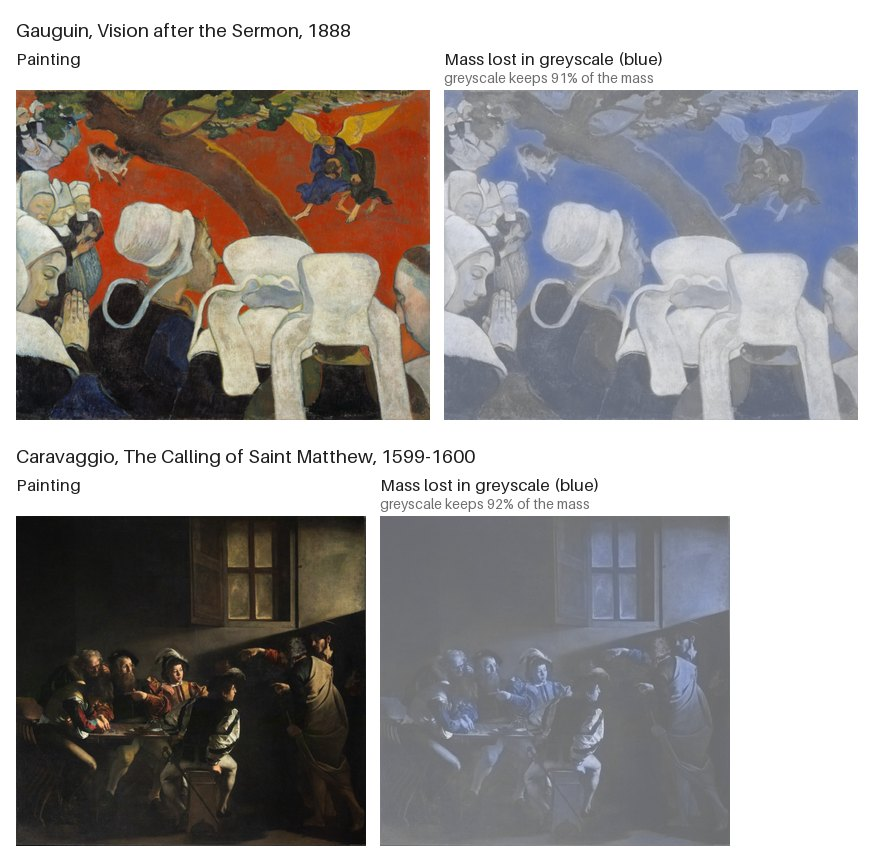
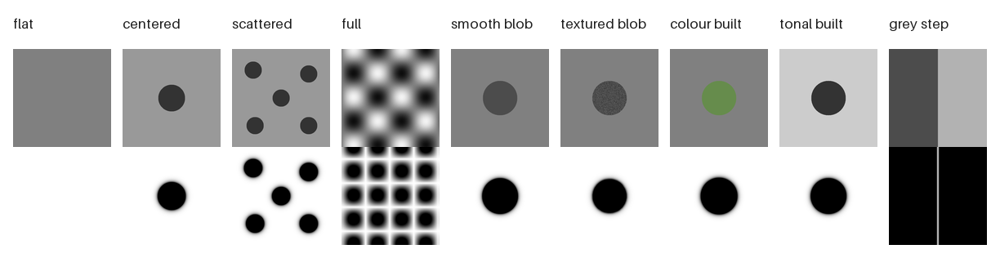
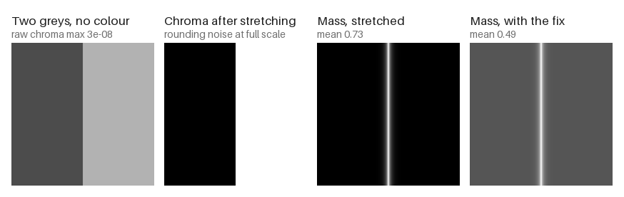

# parallax-notan

Find the big light and dark shapes in a picture the way a painter squints, and see which
parts of it are built from value and which from colour.



The ground is each picture's own median tone. In the Caravaggio that is the dark wall,
so the wall reads as flat (grey) and the lit figures and window read as the masses.

- **Notan mass**: a map of where the picture's masses are. Texture does not fool it; a
  brushy shape reads as one mass and a flat ground reads as empty.
- **Construction signature**: degrades the image (greyscale, tone curve, contrast) and
  measures which change destroys the masses, for the whole picture and pixel by pixel.

**[Try it in your browser](https://parallaxmetrology.github.io/notan/)**: drop in a
picture and see its mass, its 2, 3 or 5 value Notan, and where colour carries the
structure. Nothing is uploaded.

Deterministic. No learned model, no recognition, no network. numpy, scipy, scikit-image
and Pillow only.

From the Image Structure Reader by [Parallax Metrology](https://parallaxmetrology.com).

## Install

```bash
pip install git+https://github.com/parallaxmetrology/notan
```

## Command line

```bash
parallax-notan read painting.jpg                  # readout + construction signature, as JSON
parallax-notan map painting.jpg -o mass.png       # the mass map (dark = more mass)
parallax-notan map painting.jpg --values 3 -o notan.png   # 2, 3 or 5 value Notan
```

## Python

```python
from parallax_notan import notan_readout, construction_read, dependence_map, notan_mass

r = notan_readout("painting.jpg")
r["field_void"]        # fraction of the frame that is flat
r["mass_centroid"]     # [x, y], -0.5..0.5, 0 is the centre

c = construction_read("painting.jpg")
c["grayscale_survival"]  # share of the mass that survives greyscale, 0..1
c["fragile_to"]          # the degradation that destroys the most structure

d = dependence_map("painting.jpg")   # per-pixel mass lost in greyscale
d["lost"]
```

`notan_mass(rgb)` returns the per-pixel map for your own analysis.

## Texture does not fool it

The same blob, smooth and filled with noise. A conventional mass map built from edges,
local tone and chroma sees only the smooth blob's outline, and breaks the textured one
into specks. Notan reads one mass both times.



Texture changes Notan's void by 0.012 and the blend's by 0.81, about 66 times more.

## Where a picture is built from colour

`dependence_map` shows which masses disappear when the colour is removed. In Gauguin's
*Vision after the Sermon* the red ground is carried by colour alone (blue), while the
bonnets and the dark dresses are carried by value. In Caravaggio's *Calling of Saint
Matthew* almost nothing is lost.



The whole-image score (`grayscale_survival`) is 91% for the Gauguin and 92% for the
Caravaggio, so on its own it barely tells them apart: across whole paintings, value
carries most of the mass. The map is where the difference shows. `construction_read`
calls a picture `"chromatic"` only when greyscale keeps less than half the mass, which
happens for shapes that exist only in colour (see the test images below), and for none
of the six paintings tried so far.

## What the readout means

| Key | Meaning |
|---|---|
| `field_void` | Fraction of the frame with mass below 0.06: flat or mid-tone. Both lighter and darker shapes count as mass, so a black square on white reads about 0 ("two masses, no empty field"). |
| `field_dispersion` | How spread the mass is around its centroid, divided by the diagonal. |
| `mass_centroid`, `offcenter_force` | Where the mass sits, and how far from centre. |
| `mass_fraction` | Fraction of the frame that carries mass. |
| `chroma_support`, `neutral` | How much colour the image has before any stretching; `neutral` is true when it has none. |
| `built`, `fragile_to` | The construction reading: `"chromatic"`, `"tonal"` or `"mixed"`. A reading, not a verdict. |

Images are read at 512 px on the longest side. The blur scales are fixed at that size, so
results are comparable across images of different sizes.

## How it works

Luminance and OKLab chroma are each stretched to 0..1 for the image, blurred at 4, 8 and
16 px, and measured as distance from the image's median value. The two are summed with
chroma at half weight and averaged over the three scales. The median is treated as the
ground tone, so a picture's dominant tone reads as empty and everything that departs from
it, lighter or darker, reads as mass.

The construction signature reruns this on raw (unstretched) values for the original and
four degraded copies, and measures `sum(min(original, degraded)) / sum(original)`: how
much of the original mass survives in place.

## Test images with known answers

`parallax_notan.stimuli` builds nine synthetic images whose right answer is not in doubt.
They are useful for scoring any mass or composition measure, not just this one. Top row:
the image. Bottom row: its Notan mass.



```bash
python -m parallax_notan.stimuli out_dir/     # writes the PNGs and EXPECTED.json
```

The colour-built disc has the same luminance as its ground, so greyscale keeps 0.1% of its
mass and it reads `"chromatic"`. The grey disc keeps 100% and reads `"tonal"`.

## A fix inherited from the source

In the Image Structure Reader, a neutral grey image has chroma of about 0.00000003 from
rounding. Stretching that to 0..1 turns it into full-strength "colour", which then makes up
a third of the measured mass. This package treats chroma below 1e-6 as no colour.



Results are identical to the instrument's on any 8-bit image with colour, and differ on
neutral ones by design. The construction signature reads raw values and is identical on
every 8-bit image. One more difference: 16-bit greyscale and float files (scans, TIFFs) are
read at their own range here, where the instrument's loader read them almost white or black.

## Known limits

- **Halos.** Blurring spreads mass a little past each shape's edge, which shows as glowing
  outlines in the mass map.
- **Whole-image construction.** The single score is dominated by value on most paintings;
  use `dependence_map` to see where colour carries structure.
- **Reproductions.** You are measuring the photograph at one scale, not the painting.
  See [How image measures lie quietly](https://www.parallaxmetrology.com/how_measures_lie.html#e6), entry 6.

## How image measures lie

[How image measures lie quietly](https://www.parallaxmetrology.com/how_measures_lie.html)
collects 19 ways a hand-built image measure returns a plausible, wrong number without
raising an error, each with a case from the Image Structure Reader's lab log, a live
demonstration and the check that catches it. Entry 2 is the grey-dust fix above. The code
for its figures is in [how-measures-lie](https://github.com/parallaxmetrology/how-measures-lie).

## Tests and figures

```bash
pip install -e '.[dev]'
ruff check .
pytest
python tools/make_readme_images.py     # rebuilds docs/images/
```

The browser demo in `docs/` is a JavaScript port (`docs/notan.js`).
`tools/js_parity.py` runs both versions on the nine test images and the four paintings and
checks that they agree (needs Node 18 or later): the mass maps to within 1e-9, the value
maps, readouts and construction readings exactly.

```bash
python tools/js_parity.py
```

`tests/test_gates.py` holds the known-answer gates. `tests/test_parity.py` compares against
the Image Structure Reader and is skipped unless that package is available
(`ISR_PATH=/path/to/instrument pytest`).

## Credits

Notan as a teaching idea comes from Arthur Wesley Dow's *Composition* (1899). OKLab is
Björn Ottosson's (2020).

Paintings, all public domain: Caravaggio, *The Calling of Saint Matthew*, Contarelli
Chapel, San Luigi dei Francesi, Rome. Paul Gauguin, *Vision after the Sermon*, Scottish
National Gallery, Edinburgh. After Pieter Bruegel the Elder, *Landscape with the Fall of
Icarus*, Royal Museums of Fine Arts of Belgium, Brussels. Jeong Seon, *Clearing after Rain
on Mount Inwang*, National Museum of Korea, Seoul.

## Citing

See [CITATION.cff](CITATION.cff), or use GitHub's "Cite this repository" button.

## Licence

Code: MIT (see [LICENSE](LICENSE)). README and figures: CC BY 4.0 (see
[LICENSE-CONTENT](LICENSE-CONTENT)). The paintings are public domain.
